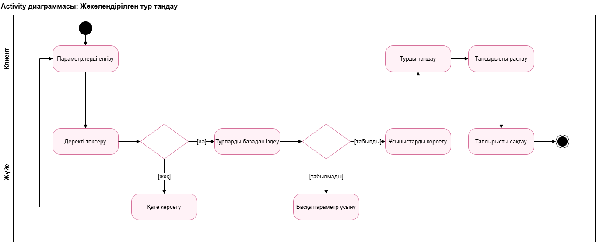

# Жекелендірілген туристік ұсыныстарды іріктеу модулі бар туристік фирманы басқарудың веб-жүйесі

Автор: Азаматкызы Аянат, BKTZh 3229-8

## Мәселе

Туристік фирмалар клиентке тур таңдауды көбіне қолмен жасайды, бұл көп уақыт алады және клиенттің қалауын толық ескермейді. Жүйе клиенттің параметрлері (ел, бюджет, күн саны) бойынша қолжетімді турларды автоматты түрде іріктеп, ыңғайлы тапсырыс беруге мүмкіндік береді. Жүйе туристік фирманың клиенттеріне және менеджерлеріне керек.

## Акторлар

- Клиент
- Менеджер
- Әкімші

## Талаптар

### Функционалдық

1. Жүйе клиенттің параметрлері бойынша турларды іріктеуі керек
2. Жүйе тапсырысты сақтауы керек

### Функционалдық емес

1. Жүйе веб-браузерде жұмыс істеуі керек

## Диаграммалар

### 1. Use Case

(кейін толтырылады)

### 2. Class

(кейін толтырылады)

### 3. Activity: Жекелендірілген тур таңдау

### 4. Sequence: Жекелендірілген тур таңдау

(4-жұмыста қосылады)
